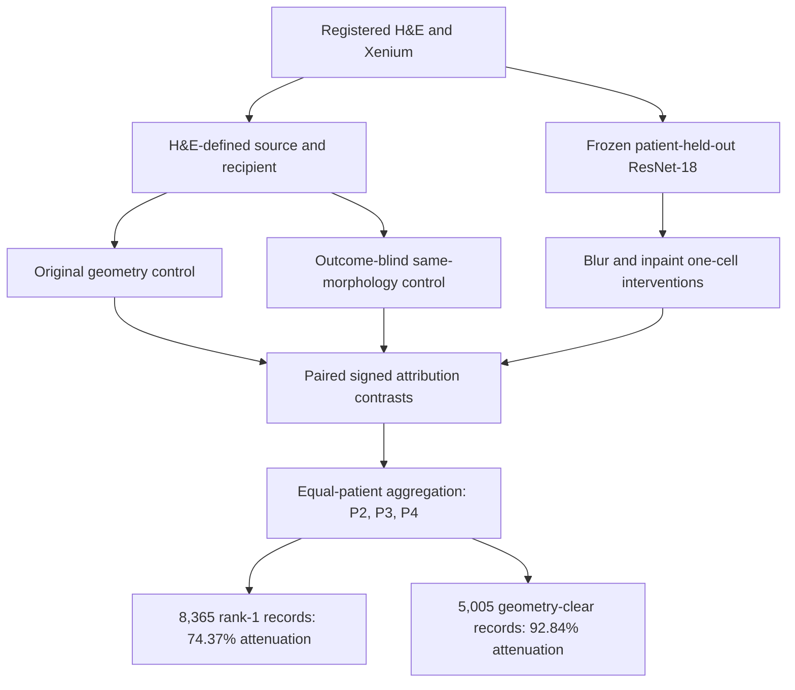

# Beyond the Recipient Cell

### Auditing Biological Source Attribution in Histology-to-Expression Models

**Anonymous research code · histology-to-expression · morphology-matched attribution**

> **Question.** Does editing a nominated neighboring H&E cell provide evidence for a *unique biological RNA source*, or is the relative response sensitive to the choice of comparison cell?

**Main result.** On the same 8,365 eligible recipient–gene records, replacing the original geometric control with a control additionally matched for broad H&E morphology and local nuclear neighborhood lowers the equal-patient signed source-minus-control contrast from **0.00698903 to 0.00179142** (**74.37% descriptive attenuation**). The model, source edit, record set, and evaluation conditions remain fixed.

| Cohort | Matching support | Sensitivity |
|---|---|---|
| 11 breast-carcinoma Xenium sections · 4 patients · 280 genes | 8,365 of 38,695 original P2–P4 records (21.62%) | 5,005 geometry-clear records; 92.84% descriptive attenuation |

## Experimental flow



The contrast is `D(c) = Δsource − Δcontrol`; consequently `D(morph) − D(original) = Δcontrol_original − Δcontrol_morph`. **The source response cancels.** Attenuation measures **comparator dependence**, not a fraction of RNA contamination or the disappearance of source sensitivity. The P2–P4 matched comparison has **three independent patient units**, so its direction is descriptive rather than population-level proof.

## Start here

The `experiments/` directory provides short, stable entry points. They delegate to the preserved implementation in `scripts/` without rewriting trained-model or matching computations.

| Reviewer task | Entry point |
|---|---|
| Train the context predictor | [`experiments/train.py`](experiments/train.py) |
| Construct corrected-expression targets | [`experiments/estimate_leakage.py`](experiments/estimate_leakage.py) and [`experiments/prepare_corrected_targets.py`](experiments/prepare_corrected_targets.py) |
| Build outcome-blind same-morphology controls | [`experiments/match_controls.py`](experiments/match_controls.py) |
| Evaluate single-cell image interventions | [`experiments/evaluate_interventions.py`](experiments/evaluate_interventions.py) |
| Aggregate patient-level paired effects | [`experiments/aggregate_patient_effects.py`](experiments/aggregate_patient_effects.py) |
| Audit geometry-clear comparisons | [`experiments/geometry_sensitivity.py`](experiments/geometry_sensitivity.py) |
| Verify rank-1 results | [`experiments/verify_results.py`](experiments/verify_results.py) |
| Run synthetic matching/replay guards | [`experiments/synthetic_contracts.py`](experiments/synthetic_contracts.py) |

### Dependency-aware synthetic check

From the repository root, with PyTorch and the scientific dependencies installed:

```bash
python experiments/synthetic_contracts.py
```

This synthetic suite **passed** on the available `bioinfo` environment before packaging; the entry-point wrapper is checked separately when this repository is prepared. Full frozen-run reproduction still requires the original data, patient-specific checkpoints, run settings and intervention outputs.

## Research modules

- `leakage_vso/`: image/prediction, geometry and target interfaces.
- `scripts/`: original research implementations, retained for traceability. Original version suffixes are frozen **source identifiers**, not multiple competing public releases.
- `configs/`: saved experimental configuration files.
- `cvpr_fair_baselines_v1/`: morphology and published-method baselines.
- `external_methods/GHIST/`: third-party GHIST implementation; license and attribution retained.
- `experiments/`: clean reviewer-facing entry points.
- `tests/`: available source tests.
- `docs/REPRODUCIBILITY.md`: section-by-section code map, inputs and verification scope.

## Data and limitations

The study uses public Xenium/HEST-indexed breast-carcinoma data with transcript QV ≥ 20. **No Xenium matrices, H&E whole-slide files, private system paths or model checkpoints are distributed here.** Corrected targets are a sensitivity proxy rather than verified endogenous transcription. The 5,005-record geometry-clear comparison is post hoc. The GHIST adaptation is not the full original GHIST pipeline. No result here establishes the physical source of individual RNA molecules.

This repository includes source and verified synthetic contracts, **not an independently completed retraining or complete production-inference replay**. See [reproducibility details](docs/REPRODUCIBILITY.md).
